# MedMLOps

[](https://github.com/AbdGhni/MedMLOps/actions/workflows/target-ci.yml)
[](https://github.com/AbdGhni/MedMLOps/actions/workflows/core-ci.yml)
[](https://github.com/AbdGhni/MedMLOps/actions/workflows/ci.yml)

**Synthetic data only · Not clinically validated · Not production-cleared.**

This is an independently initialized, privacy-sanitized public source snapshot.
Historical local evidence is retained with personal paths and private revision
references redacted; it does not attest execution on the new public Git history.
See [publication notes](docs/publication/PUBLICATION.md) for the current validation
and [GitHub Actions](https://github.com/AbdGhni/MedMLOps/actions) for actual remote results.
The existing MIT license is confirmed by the owner.

**A locally demonstrable ML platform for a synthetic healthcare event.**

Release candidate: **2.0.0rc1**. A portfolio project for ML/MLOps engineering
in MedTech and pharmaceutical environments.

MedMLOps implements a reproducible dataset-to-deployment lifecycle with DVC,
MLflow Tracking and Model Registry, PostgreSQL governance, FastAPI, Evidently,
Prometheus and Grafana. All observations are fictitious. Predictions have no
clinical validity and do not provide medical recommendations.

## Business and engineering problem

An experiment is only one part of ML delivery. Teams also need to identify the
dataset and code behind a model, approve changes, know which artifact is served,
detect incidents and recover a prior version. MedMLOps demonstrates these
engineering boundaries on an artificial healthcare event. It makes no claim
of patient benefit or regulatory certification.

| Layer | Implementation |
|---|---|
| Data / experiments | Python 3.12, NumPy, pandas, Pydantic, scikit-learn; LR and bounded RF |
| Reproduction / tracking | DVC DAG and local cache/remote; MLflow Tracking and Registry |
| Governance / serving | PostgreSQL approvals, audit and deployment pointer; FastAPI/Uvicorn |
| Observability | Evidently HTML/JSON, Prometheus scrape/alerts, provisioned Grafana |
| Delivery | Docker Compose, hash-locked dependencies; CI and manual CT/CD definitions |

## Verified local platform

The [recorded end-to-end run](docs/validation/phase4/end-to-end.json) exercised
actual services, including controlled promotion, authenticated predictions,
synthetic drift, alerts, rollback and persistence after container recreation.
The v1 reference and v2 mathematical core remain tested.

| Capability | Executed evidence |
|---|---|
| Synthetic snapshots and strict Pydantic inputs | Seed/hash reproducibility; adversarial schemas |
| DVC five-stage pipeline | Repro, no-op, forced hash parity, seed invalidation and older checkout |
| LR and bounded RF | Five-fold train CV; validation-only selection; held-out metrics and calibration |
| MLflow Tracking/Registry | Real LR/RF runs, params, metrics, artifacts, versions and aliases; safe numeric pyfunc parity |
| Approval and PostgreSQL audit | Verified candidate evidence, explicit actor, atomic pointer/audit/outbox |
| FastAPI/Uvicorn | Authenticated HTTP; 401/422/413/503; pinned version and corruption rejection |
| Evidently and labelled monitoring | HTML/JSON reports; stable, shifted and reversed-label scenarios |
| Prometheus/Grafana | Actual scrape, firing rule, latency quantiles, datasource health and provisioned dashboard API |
| Rollback and restart | Actual served version restored; failure compensation; durable runs/artifacts/audit |
| Local quality checks | Regression/API suite plus live integration; Ruff and scoped Mypy; latest results in Phase 5 report |
| GitHub Actions | CI/manual CT/controlled CD prepared; remote execution and publication pending |

Known release limits: the audit still reports unpatched transitive DiskCache/NLTK
advisories, so the security gate is not green. Browser automation was unavailable
in this session: dashboard provisioning and queries were verified through APIs;
rendered-panel screenshots are not claimed. See the
[current dependency review](docs/validation/phase5/SECURITY_REVIEW.md) and
[Phase 5 report](docs/validation/phase5/FINAL_REPORT.md). The three raw findings
include a duplicate DiskCache advisory: two distinct vulnerabilities remain open.

## Run locally

Prerequisites: Python 3.12, a committed Git checkout and Docker Desktop with the
Linux engine. From the repository root in PowerShell:

```powershell
python -m venv .venv
.venv/Scripts/python.exe -m pip install --index-url https://pypi.org/simple pip==26.2.1
.venv/Scripts/python.exe -m pip install --index-url https://pypi.org/simple --require-hashes -r requirements-target.lock
.venv/Scripts/python.exe -m scripts.bootstrap_local
.venv/Scripts/python.exe -m medmlops.pipeline all --work runtime/phase4
docker compose up --build -d --wait --wait-timeout 240
$env:MEDMLOPS_EVIDENCE_DIR = 'runtime/demo-evidence'
.venv/Scripts/python.exe -m scripts.check_tracking
.venv/Scripts/python.exe -m scripts.validate_phase4
```

Use `.venv/bin/python` on Linux, with
`export MEDMLOPS_EVIDENCE_DIR=runtime/demo-evidence` instead of PowerShell's `$env:`.
The bootstrap creates random local credentials
in ignored `.env`. Managed sessions must use authorized elevation for network,
Docker or Git operations when required. The validation command runs fault drills
and recreates containers without deleting volumes; use this single-operator demo
stack, not a shared deployment. See the [complete runbook](docs/runbooks/phase4-local.md).

| Interface | Local address |
|---|---|
| MLflow experiments and registry | http://127.0.0.1:5000 |
| FastAPI OpenAPI | http://127.0.0.1:8000/docs |
| Prometheus targets and alerts | http://127.0.0.1:9090 |
| Grafana dashboard | http://127.0.0.1:3000/d/medmlops-v2 |

Grafana login: `admin`, with the generated password from `.env`. Predictions and
readiness require the API bearer token from `.env`. All ports bind to loopback.
Swagger exposes an Authorize button for the HTTP bearer scheme; enter the token
locally and keep it out of screenshots. No authentic UI screenshots are available
yet; the [demo script](docs/portfolio/DEMO_SCRIPT.md) provides a capture checklist.
MLflow is a trusted local operator service; it is not an authenticated multi-user
registry exposed to the internet.

## Model lifecycle

```mermaid
flowchart LR
  D[Synthetic snapshot] --> V[DVC validation and preparation]
  V --> T[LR/RF train CV and validation selection]
  T --> M[MLflow candidate versions]
  M --> G[Artifact integrity and held-out quality gate]
  G --> A[Explicit operator approval in PostgreSQL]
  A --> P[Atomic deployment pointer and audit outbox]
  P --> F[FastAPI pinned numeric model]
  F --> O[Evidently and Prometheus/Grafana]
  O --> I[Operator incident review]
  I --> R[Verified rollback to prior approval]
  R --> P
```



Training never implicitly approves or deploys. MLflow aliases describe registry
roles; the PostgreSQL pointer determines what is served. Artifact hashes and v2
schema checks gate loading. Both algorithms use non-executable numeric JSON;
the MLflow pyfunc flavor uses the trusted installed loader, without model pickle.
The API's PostgreSQL role cannot deploy or rewrite audit history.

The simulated quality thresholds are AUC ≥ .78, sensitivity ≥ .75, specificity
≥ .40, Brier ≤ .20 and train/serve error ≤ 1e-12. The 4,000-subject fixture uses
disjoint 60/20/20 partitions and train-only cross-validation/scaling. LR is selected
by validation ROC-AUC; its held-out AUC is .86698 versus RF .83770. These are
synthetic exercise results, not evidence of medical performance.

Monitoring separates data drift, prediction drift and labelled performance loss.
Unlabelled performance is unavailable and windows below 100 observations are
inconclusive. Alerts persist as incidents and do not retrain or promote models.
The nine Grafana panels cover throughput, error ratio, p50/p95/p99 latency,
served version, lifecycle events, drift and governance availability.

## Reproduce and test

Tests cover the preserved v1 prototype, v2 data/partition/artifact contracts,
model parity and adversarial FastAPI inputs. The separate live integration lane
executes actual PostgreSQL/MLflow/HTTP/Compose/monitoring interactions, including
failure injection and persistence. These checks are distinct from browser rendering
and remote CI. Scoped Mypy is not strict typing of the entire legacy codebase.

```powershell
.venv/Scripts/python.exe -m pip check
.venv/Scripts/python.exe -m pytest -q -p no:cacheprovider
.venv/Scripts/python.exe -m ruff check medmlops scripts tests
.venv/Scripts/python.exe -m scripts.check_dvc
.venv/Scripts/python.exe -m pip_audit --format json --output runtime/dependency-audit.json
```

`requirements-target.lock` pins the resolved Windows/Linux dependencies with PyPI
SHA256 distribution hashes. The Docker build verifies these hashes in a fresh
Linux environment. The local DVC remote/cache resides in the ignored repository
runtime. DVC metadata goes to Git; cohorts, models, credentials and caches do not.
Reports include dataset/source/model hashes, commit/dirty state, parameters and
dependency versions. Uncommitted training is rejected for controlled approval.

The NumPy 2 forest comparison boundary discovered during changed-seed reproduction
has a regression test. Same-platform forced reproduction gives identical numeric
model hashes; cross-platform numerical byte identity is not claimed.

The preserved v1 Flask/SQLite prototype remains available through
`python -m medmlops.cli demo` and its legacy tests. It does not serve v2 candidates.
The five-stage v2 Python core remains usable without service integrations;
`requirements-core.txt` installs that lane. Target tests skip if target packages
are absent. `compose.yaml` and the Dockerfile now deploy the target stack.

## Documentation

- [Local operator runbook](docs/runbooks/phase4-local.md)
- [Actual end-to-end evidence](docs/validation/phase4/end-to-end.json), [MLflow evidence](docs/validation/phase4/tracking.json), [DVC evidence](docs/validation/phase4/dvc.json)
- [Current status and release limits](docs/validation/phase4/status.md)
- [Architecture diagrams](docs/architecture/diagrams.md) and [ADRs](docs/adr/0001-target-stack-and-legacy.md)
- [Data contract](docs/data-contract-v2.md), [regulatory boundary](docs/validation/regulatory-boundary.md)
- [Portfolio description](docs/portfolio-draft.md), [backlog](docs/Tickets.md), [progress](docs/Progress.md)
- [Recruiter overview](docs/portfolio/PROJECT_OVERVIEW.md), [technical deep dive](docs/portfolio/TECHNICAL_DEEP_DIVE.md), [architecture decisions](docs/portfolio/ARCHITECTURE_DECISIONS.md)
- [5–10 minute demo](docs/portfolio/DEMO_SCRIPT.md), [30 interview questions](docs/portfolio/INTERVIEW_QA.md), [CV bullets](docs/portfolio/CV_BULLETS.md), [limitations](docs/portfolio/LIMITATIONS.md)
- [Release candidate](docs/validation/phase5/RELEASE_CANDIDATE.md), [license inventory](docs/validation/phase5/LICENSE_REVIEW.md), [GitHub setup](docs/validation/phase5/GITHUB_READINESS.md)

## Roadmap

Resolve upstream advisories, split service dependency locks, pin external actions
and images immutably, add enterprise identity and signed approvals, exercise
off-host backup restores and capture authentic interfaces. A real medical product
would additionally require independently governed clinical validation and a
regulatory program outside this synthetic demonstration.

GitHub workflows have not run remotely, and no commits have been pushed. Manual
CD requires configured reviewers and a local self-hosted runner. Cloud, enterprise
IAM, HA, real patient data and clinical deployment are outside this demo. The MIT
license file predates Phase 5 and is preserved; owner confirmation is pending
before publication. No new license has been added.
