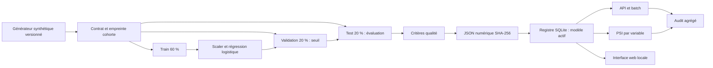

# Architecture

> Architecture historique v1 ; cible actuelle : `architecture/diagrams.md` et `architecture/components.md`.

## Décisions

1. **Données synthétiques.** Démonstration immédiatement exécutable et partageable, sans téléchargement ni dossier patient. La simulation ne permet aucune conclusion sur un événement réel.
2. **Baseline linéaire.** Faible coût CPU, reproductible, preprocessing simple et parité train/serve vérifiable. Le générateur est lui-même logistique : cette proximité explique la performance et limite la portée du benchmark.
3. **JSON numérique.** Le bundle contient uniquement schema, ordre des variables, scaler, coefficients, seuil, histogrammes et provenance. Aucun pickle ou exécution de code au chargement. Un SHA-256 vérifié à chaque chargement détecte les modifications accidentelles. Ce hash ne constitue pas une signature d’autorité.
4. **Registre local transactionnel.** SQLite garantit que le pointeur actif et l’événement de promotion sont écrits dans une transaction. Les modèles sont écrits avant enregistrement du run. Une interruption à cet endroit peut laisser un artefact orphelin, qui n’est jamais actif.
5. **Promotion explicite.** Les critères sont enregistrés avec le rapport ; seuls les runs acceptés peuvent devenir actifs, y compris lors d’un rollback. L’API ne propose pas d’entraînement ou de promotion à distance.
6. **Surveillance séparée de l’inférence.** Les mesures individuelles sont utilisées en mémoire puis abandonnées. Seuls les comptes, latences et histogrammes agrégés de dérive sont persistés. Cela évite de stocker chaque requête pour calculer le PSI.
7. **Dépendances limitées.** Flask, NumPy et scikit-learn, versions fixées ; tests standard `unittest`. Le registre remplit ici le rôle de suivi d’expériences. MLflow, orchestration distribuée, feature store et Kubernetes ne sont pas requis pour le parcours local.

## Reproductibilité et provenance

Chaque modèle porte la seed, l’empreinte de la cohorte et celle des sources `data.py`, `model.py`, `train.py`. Le rapport conserve versions des bibliothèques, configuration d’algorithme et empreintes des partitions. Avec les mêmes sources et l’environnement vérifié, deux entraînements de seed 42 donnent le même modèle. La reproductibilité bit à bit entre architectures CPU ou versions de BLAS différentes n’est pas garantie ; les tests contrôlent également la parité numérique à 1e-12.

Le scaler est ajusté exclusivement sur train. Le seuil est choisi exclusivement sur validation pour atteindre une sensibilité cible de 85 %. Les critères de test sont fixés dans le code avant l’évaluation. Le bootstrap n’entraîne pas un nouveau modèle ; il décrit la variabilité d’échantillonnage du test, conditionnellement au modèle entraîné.

## Frontières de confiance

Les opérateurs ayant accès au disque et à la base font partie du périmètre de confiance. Le jeton protège les appels à l’API, sans séparer plusieurs rôles. L’API refuse les champs supplémentaires, borne les variables, limite le corps à 1 Mio et les lots à 1 000 mesures. Les erreurs ne renvoient pas les valeurs reçues. Les logs d’accès Flask contiennent méthodes et chemins fixes, sans corps de requête.

Le serveur Flask livré est réservé au poste local et aux conteneurs de démonstration. Une exploitation réelle exige un serveur WSGI de production, TLS, gestion des identités et secrets, limitation de débit, registre signé, stockage contrôlé et surveillance opérationnelle externe.

Sources techniques : [persistance scikit-learn](https://scikit-learn.org/stable/model_persistence.html), [test client Flask](https://flask.palletsprojects.com/en/stable/testing/).
