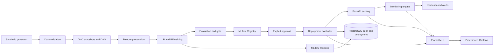
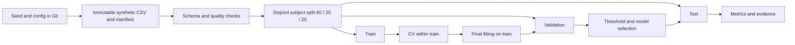
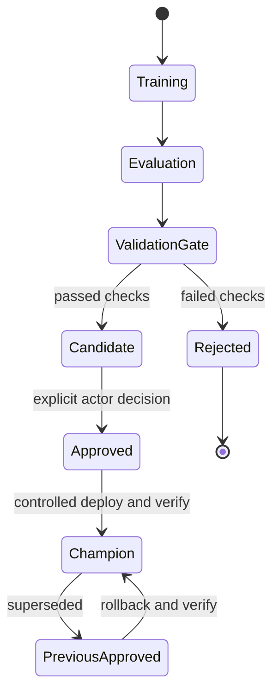
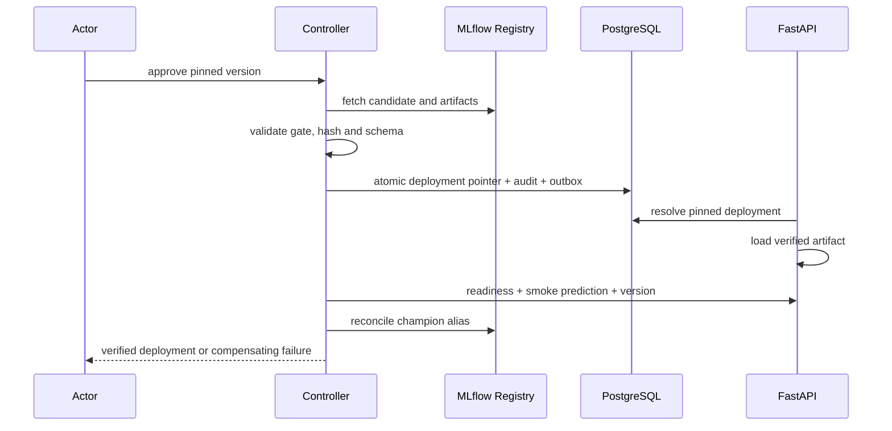
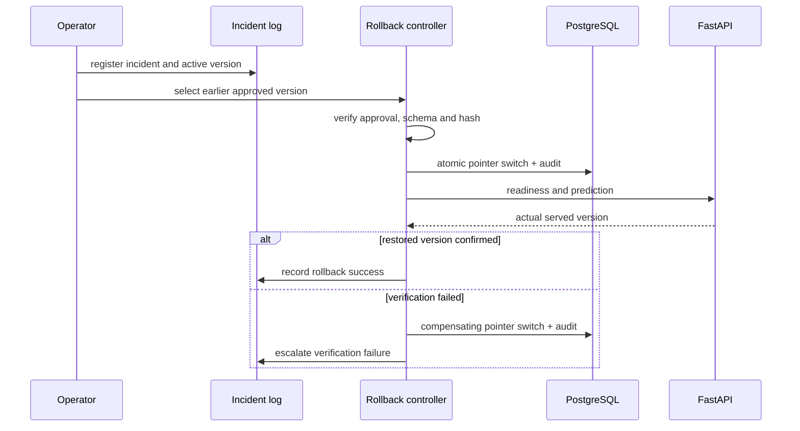
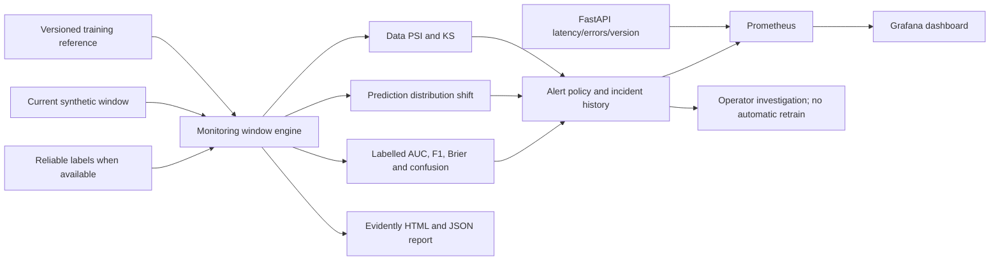

# Target architecture diagrams

These diagrams describe the locally implemented v2 stack. Executed service evidence
and remaining release restrictions are in `docs/validation/phase4/status.md` and
`docs/validation/phase5/FINAL_REPORT.md`. They do not imply a cloud or clinical deployment.

## Global architecture


## Data flow


## Model lifecycle


## Training sequence
```mermaid
sequenceDiagram
  participant O as Operator/explicit CT
  participant D as DVC
  participant T as Training
  participant M as MLflow
  participant G as Gate
  O->>D: reproduce commit + parameters
  D->>T: verified disjoint partitions
  T->>T: CV, fit, validation selection, test
  T->>M: parameters, dataset, commit, metrics, artifacts
  T->>G: candidate report and hash
  G->>G: verify integrity and acceptance
  G-->>O: Candidate or Rejected; no auto-promotion
```

## Deployment sequence


## Rollback sequence


## Monitoring architecture

